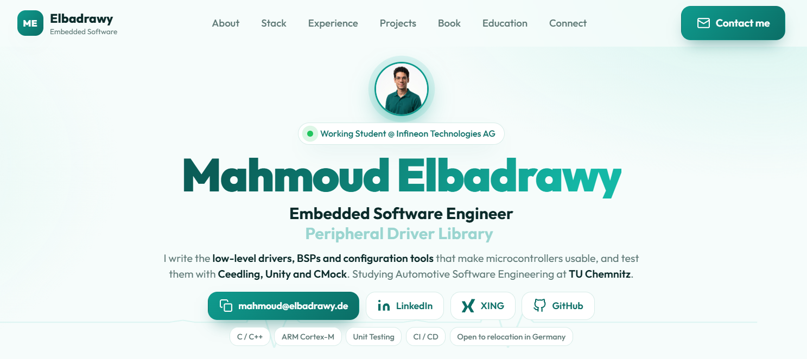

<!--
  Mahmoud Elbadrawy | GitHub Profile
  Portfolio: https://elbadrawy.de
-->

<!-- Clickable live portfolio preview -->

  

## Hi, I am Mahmoud.

I'm an **Embedded Software Engineer** and working student at **Infineon Technologies AG**, where I work on embedded software components, low-level drivers, microcontroller examples, and Device Configurator tooling.

I'm pursuing an **M.Sc. in Automotive Software Engineering at TU Chemnitz**. My interests include ARM-based systems, peripheral drivers, embedded C, unit testing, automotive software, and building reliable firmware with practical development workflows.

I enjoy working close to the hardware while applying sound software engineering practices — from debugging and testing to automation and clear technical documentation.

> *Building the software that drives tomorrow's mobility.*

## What I'm Working On

- Developing and extending embedded software drivers and examples for new microcontroller platforms.
- Implementing peripheral features in Infineon's Device Configurator.
- Building interactive graph views for peripheral data flow, enable states, and clock routing.
- Improving embedded C development workflows with CMake, unit testing, containers, and GitHub Actions.
- Learning and applying software testing practices for resource-constrained systems.

## Experience

### Infineon Technologies AG — Working Student, Embedded Software Engineer
**Dresden, Germany · November 2025 – Present**

- Develop and extend low-level software drivers and example implementations for new microcontroller platforms.
- Migrate embedded examples to new platforms and resolve bugs in drivers and example implementations.
- Implement peripheral features in Device Configurator.
- Develop interactive graph views for peripheral data flow, and enable states, including real-time error highlighting.

### CELERITAS-8 GmbH — Working Student, Software Developer
**Leipzig, Germany · March 2025 – October 2025**

- Digitalized and simplified accounting processes using Odoo-based software solutions.
- Implemented a customer portal with dashboards and KPI visualizations.
- Developed a responsive accounting landing page integrated with the company's system.

## Tech Stack

**Programming Languages**

**Embedded & Automotive**

**Protocols & Interfaces**

**Tools & Development**

## Featured Projects

<table>
  <tr>
    <td width="50%" valign="top">
      
      <h3><a href="https://github.com/mahmoud-elbadrawy/c-project-template">Embedded C Project Template & CI/CD</a></h3>
      
Modular embedded C template with CMake, Ceedling, Unity, CMock, Docker, and GitHub Actions for repeatable builds and automated unit tests.

      C · CMake · Ceedling · Unity · CMock · Docker · GitHub Actions
    </td>
    <td width="50%" valign="top">
      
      <h3><a href="https://github.com/mahmoud-elbadrawy/smart_parking">Smart Parking System</a></h3>
      
ATmega32 parking management system using sensor inputs to detect availability and control automated gate access.

      C · ATmega32 · AVR · GPIO · Sensors
    </td>
  </tr>
  <tr>
    <td width="50%" valign="top">
      
      <h3><a href="https://github.com/mahmoud-elbadrawy/smart_home">Smart Home Control System</a></h3>
      
ATmega32 home automation integrating temperature and light sensing, LCD feedback, keypad input, and servo control.

      C · ATmega32 · LM35 · LDR · LCD · PWM
    </td>
    <td width="50%" valign="top">
      
      <h3><a href="https://github.com/mahmoud-elbadrawy/tips_dashboard">Tips Dashboard</a></h3>
      
Interactive dashboard for exploring restaurant tipping patterns through data analysis, statistical summaries, and visualizations.

      Python · Streamlit · Pandas · Data Visualization
    </td>
  </tr>
  <tr>
    <td width="50%" valign="top">
      
      <h3><a href="https://github.com/mahmoud-elbadrawy/VHDL">VHDL Lessons & Concepts</a></h3>
      
Structured VHDL concepts, practical examples, and exercises covering digital design fundamentals with Xilinx Vivado simulations.

      VHDL · Digital Design · Vivado
    </td>
    <td width="50%" valign="top">
      
      <h3><a href="https://github.com/mahmoud-elbadrawy/TCL">Tcl Scripting & Notes</a></h3>
      
Scripts and learning notes covering scripting fundamentals, task automation, and tool configuration for EDA workflows.

      Tcl · Automation · Scripting · EDA Tools
    </td>
  </tr>
</table>

## Writing

### Unit Testing for Embedded Systems

I'm working on a beginner-friendly, step-by-step guide to testing embedded C without hardware. It is intended for engineers who are new to unit testing and want to get started without needing a lab full of development boards.

Interested in the book? [Get in touch](mailto:mahmoud@elbadrawy.de).

## Education

| Qualification | Institution | Period |
|---|---|---|
| M.Sc. Automotive Software Engineering | TU Chemnitz, Germany | October 2024 – March 2028 (expected) |
| B.Eng. Communication & Computer Engineering | Mansoura University, Egypt | October 2019 – July 2024 |
| Microcontroller Architecture & Interfaces (AVR) | NTI, Egypt | October – November 2023 |
| Embedded Systems Summer Program | Sprints, Egypt | July – October 2023 |
| C & Embedded-C Programming | NTI, Egypt | August – September 2023 |
| Parallel Education Program | IMT School, Egypt | January – April 2024 |

## Languages

- 🇪🇬 **Arabic** — Native
- 🇬🇧 **English** — C1
- 🇩🇪 **German** — A2 (actively improving)

---

### Let's Connect

I'm open to junior embedded software opportunities in Germany, particularly in embedded systems, automotive software, and IoT.

*Building reliable embedded software, one byte at a time.*

